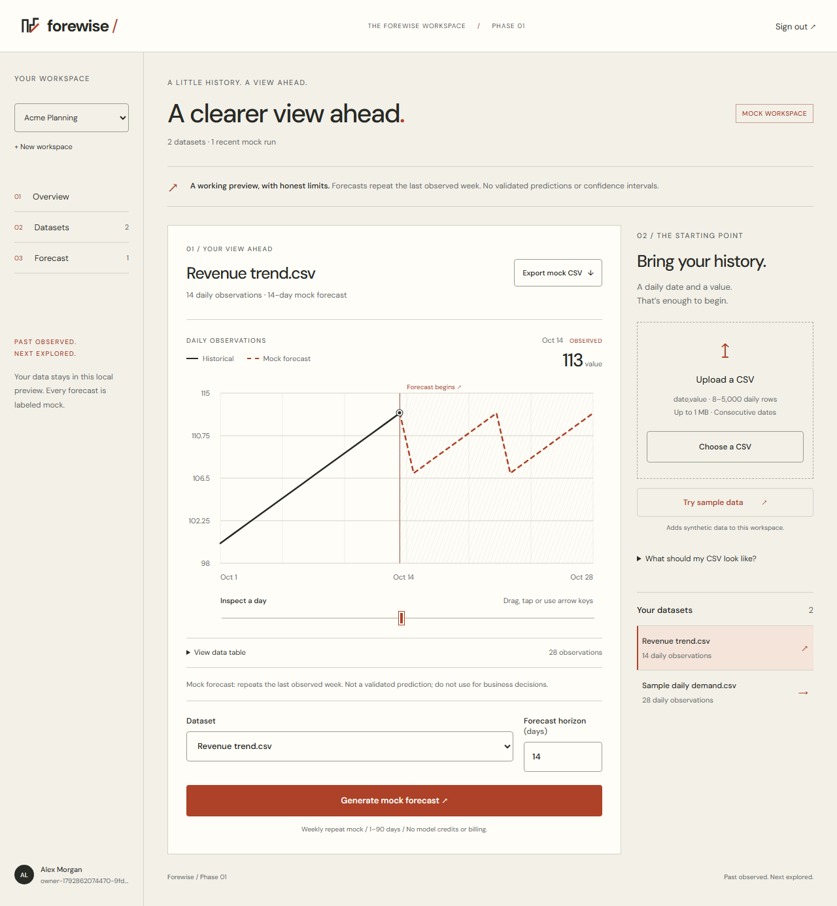

# Forewise

An independent TypeScript/Python forecasting-workspace prototype. **Main branch: Phase 01, local development preview with mock forecasts.** No hosted deployment, payments, or external model calls are configured on this branch.

## Portfolio review: API and data integration

This is an independent engineering project, not a customer case study. The
`main` branch is the Phase 01 local prototype: its forecast is explicitly a
weekly-repeat **mock**, not a trained or validated forecasting model. Later
development branches explore additional features; the instructions below
describe `main` only.

The useful integration example is the complete data flow:

1. A Next.js interface uploads a daily CSV, which is validated server-side.
2. Authenticated API routes enforce workspace membership and persist the data.
3. TypeScript calls a separate Python/FastAPI service using a server-only
   bearer token, a bounded timeout and explicit failure handling.
4. The result is stored, visualised and exported, with mock output labelled.

Start the code review with:

- [Next.js API boundary](apps/web/app/api/%5B...path%5D/route.ts)
- [Python service and request validation](services/forecast/app.py)
- [CSV validation](apps/web/lib/csv.ts)
- [Restricted database role and tenant boundary](packages/db/src/index.ts)
- [API contract](docs/API.md) and [architecture](docs/ARCHITECTURE.md)
- [Contract tests](services/forecast/test_app.py) and
  [browser/API scenarios](e2e/phase01.spec.ts)



The screenshot is an existing local test capture with synthetic data, not a
live customer deployment. Historical verification is recorded in
[the Phase 01 gate](docs/PHASE-01.md); it does not certify subsequent commits.


## Run locally

Requires Node.js 22.13+ (validated on 24.18), Python 3.12+, npm, and approximately 1 GB free space for dependencies. Docker is not required.

```powershell
npm ci
python -m venv .venv
.\.venv\Scripts\python.exe -m pip install -r services/forecast/requirements.lock.txt
npm run dev
```

Open **http://127.0.0.1:3000**. Create an account with any test email and a password of 12–128 characters; email delivery is not connected. No seeded credentials. `npm run dev` starts Next.js and the Python service, creates a random local service token in the ignored `apps/web/.env.local`, and binds both services to loopback. Ctrl+C stops both. On macOS/Linux use `.venv/bin/python` for installation.

One local Next.js process may open the persistent database at a time. Data is stored inside `apps/web/.data/forewise`, excluded from Git. This is a development storage adapter, not a hosted production database. To change ports/origin, configure `.env.local` and the process commands together; requests must match `APP_ORIGIN` (default `http://127.0.0.1:3000`).

## What works

- Responsive landing, sign-up/sign-in, logout and protected workspace.
- Real salted password hashing and server-side sessions; session cookies are HttpOnly and SameSite=Lax, Secure when served over HTTPS.
- Create/switch workspaces; membership checks and real PostgreSQL row-level security protect tenant data.
- Upload and validate daily `date,value` CSV files, or load synthetic sample data.
- Persist datasets and mock forecast runs; visualize history/output and export a mock CSV.
- A separate internal FastAPI process returns explicitly labelled weekly-repeat mock outputs. **No trained forecasting model is integrated in Phase 01.**

CSV contract: UTF-8, exactly `date,value` columns, 8–5,000 consecutive daily observations, unique valid `YYYY-MM-DD` dates, finite numerical values within ±1e12, file below 1 MB. Rows are sorted by date. Forecast horizon: 1–90 days. Monthly/irregular/multivariate data is not supported in Phase 01.

## Commands

The complete local source gate is `npm run verify` (requires `uv` for pinned Ruff and pip-audit tools). It stops at the first failed check and writes logs plus exit codes to the ignored `.data/checks/` directory. It does not provision infrastructure, run paid CI, or deploy. Browser checks remain a separate command against a running local preview, so a stale build cannot be mistaken for the just-built version.

```powershell
npm run typecheck
npm run lint
npm run check:format
npm run verify
npm test
.\.venv\Scripts\python.exe -m pytest services/forecast -q
npm run build
npx playwright install chromium
# Keep npm run dev running in another terminal:
npm run test:e2e
```

Browser tests create synthetic users/data in the local development database. They cover desktop/mobile layout, registration, invalid and valid upload, mock forecasting/export, reload, workspace switching, login/logout, CSRF and cross-account access. Screenshots are saved in `docs/screenshots/`; the transient browser report is ignored.

## Repository map

| Path                  | Responsibility                                                                   |
| --------------------- | -------------------------------------------------------------------------------- |
| `apps/web/app`        | Next.js App Router pages and same-origin API                                     |
| `apps/web/components` | Landing/auth/workspace presentation                                              |
| `apps/web/lib`        | Password/session helpers, CSV validation, local database singleton               |
| `packages/db`         | PostgreSQL schema, restricted role, RLS transaction boundary and isolation tests |
| `services/forecast`   | Separate Python mock forecasting API and contract tests                          |
| `e2e`                 | Playwright browser and API integration tests                                     |
| `scripts/dev.py`      | Local process orchestration and generated internal service token                 |
| `docs`                | Architecture, source verification and Phase 01 gate evidence                     |

See [architecture](docs/ARCHITECTURE.md), [API contract](docs/API.md), [starter verification](docs/STARTER.md), and [Phase 01 gate](docs/PHASE-01.md).

The development workflow and review findings are recorded in [Phase 01 review](docs/PHASE-01-REVIEW.md). Changes are proposed through a private pull request; merging does not authorize Phase 02 or production deployment.

The Fieldnotes redesign, primary references, three art directions, before/after captures and three visual critique passes are indexed in [the design review](docs/design/README.md). Project-wide creative/QA expectations persist in [AGENTS.md](AGENTS.md).

Visual checks: `node scripts/capture-design.mjs after` captures 10 states at 1440/768/390px. `node scripts/audit-accessibility.mjs after` captures public-page axe findings. `npm run test:e2e` includes functional, WCAG, keyboard/reduced-motion, signed-chart and six screenshot regression checks. Baselines in `e2e/design.spec.ts-snapshots/` are for Chromium on Windows; update them only after inspecting intentional visual changes. The application must be running from the just-built code.

## Boundaries

Phase 01 is not a production-ready release. Email verification/recovery, invitations, infrastructure hardening, hosted PostgreSQL migration, backups, customer data handling, a job queue, real model evaluation and billing need later decisions. There are no customer logos, fabricated testimonials, validated accuracy claims, published prices, or invented traction. Source is public for portfolio review; no additional license grants for Forewise source are made here. Dependency licenses remain with their respective authors.

**STOP: owner review of Phase 01 is required before starting Phase 02 or deployment.**
