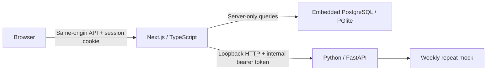

# Phase 01 architecture

## Process and trust boundaries

The browser never receives database credentials, password hashes, session hashes or the internal forecast service token. Python receives only validated observations and the horizon; it does not receive email, session cookies, workspace identifiers or persist tenant data. No external AI vendor or storage provider is called. Fonts are bundled locally.

## Database and tenant isolation

Schema v1 is maintained in `packages/db/src/index.ts`. Entities: users, hashed sessions, login-attempt counters, workspaces, memberships, datasets and forecasts. A composite foreign key `(dataset_id, workspace_id)` prevents a forecast from referencing another workspace's dataset.

Authentication and provisioning use the server-only owner connection. Every business data query uses `asUser`, a PostgreSQL transaction that sets the authenticated user ID using `set_config(..., true)` and then switches to the `forewise_app` role with `SET LOCAL ROLE`. The role is `NOSUPERUSER NOBYPASSRLS`. It cannot read authentication tables or modify memberships/workspaces. Membership visibility is restricted to the authenticated user. Workspace/dataset/forecast policies check visible memberships. `SET LOCAL` state expires at transaction completion. Queries also filter the requested workspace; the API checks membership before handling data operations.

The local database runs embedded PostgreSQL through PGlite, persists to a directory, and requires one Next.js process. Docker was unavailable at implementation time. This avoids silently creating paid infrastructure or altering an existing database. **It is not a multi-instance production deployment.** A later PostgreSQL adapter must preserve the restricted-role transaction boundary and rerun the RLS tests on the hosted database. The owner connection necessarily bypasses RLS for signup; it must never be exposed to clients.

## Authentication

Passwords use random 128-bit salt and Node scrypt with a 64-byte result; verification uses timing-safe comparison. Sessions use random 256-bit tokens, store SHA-256 digests server-side, expire after seven days and are deleted on logout. Cookies are HttpOnly, SameSite=Lax and Secure over HTTPS. Protected pages validate sessions on the server; the API independently validates every request. Mutations reject missing/foreign Origin using a fixed configured APP_ORIGIN. Errors return a generic message without database details.

Persistent account-based attempt counters allow eight attempts per 15 minutes. Phase 01 caps workspaces at ten per account and datasets at twenty per workspace. These are bounded local-preview limits, not a complete public abuse-prevention system. Before public use: edge/IP controls, total storage limits, account enumeration review, recovery/email verification, secure transport, session management/cleanup and a security review.

## Forecasting boundary

The service contract is intentionally replaceable. Phase 01 repeats the latest seven daily observations and labels the result `mock: true` and `weekly-repeat-mock-v1`. It provides no confidence bands, accuracy score or model-selection claim. Python validates input independently and requires a >=32-character configured shared secret. The web server uses a ten-second timeout and returns a recoverable 503 when Python cannot be reached. Saved datasets remain available. No payment provider, pretrained weights, commercial model or heavy training dependency is installed.

## Known limits

Synchronous HTTP is acceptable for this bounded mock. A real model worker requires a durable job queue, idempotency, cancellation, quotas and run states. Daily univariate CSV only; no arbitrary business problem guarantee. There is no invitation flow, team administration, password recovery, customer-facing billing, audit log or production telemetry in this gate. Do not deploy this local adapter as serverless/multi-instance infrastructure.
